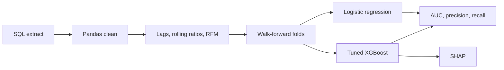
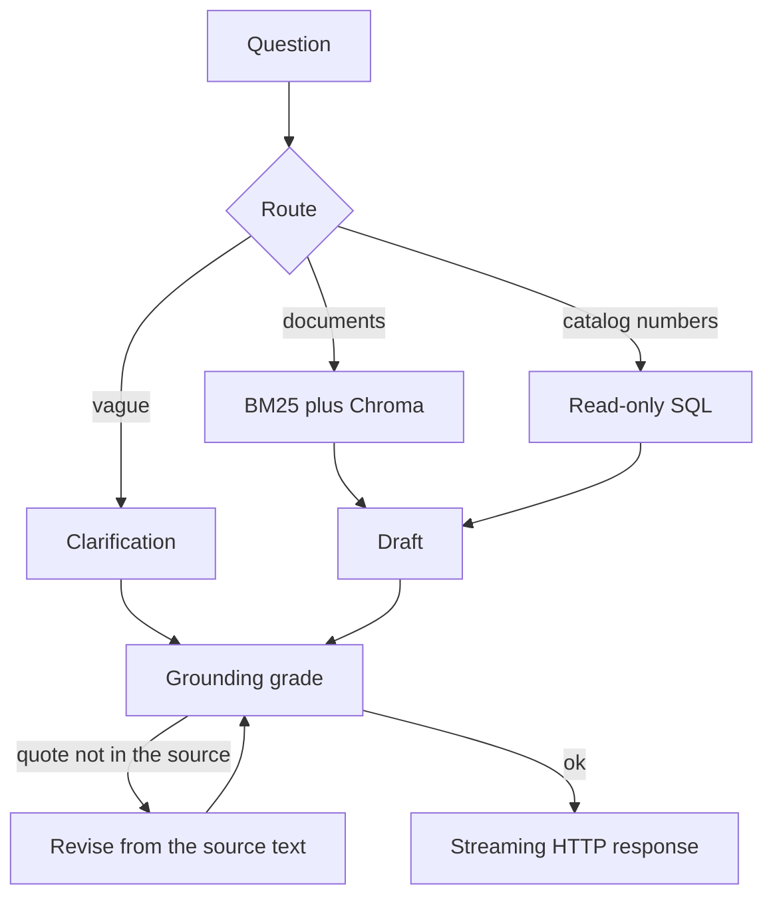

# AlphaChurn

AlphaChurn scores the chance that a customer churns, using only activity that had already happened on a snapshot date, and it explains each score. The same repository holds DocuMind, a separate program that answers questions from PDF and Markdown files and cites the page.

They do not share a runtime. AlphaChurn is a batch training and scoring pipeline. DocuMind is a small HTTP service.

## AlphaChurn

A subscription business usually has a customer table and an event table: purchases, logins, support tickets, and a cancel. The pipeline extracts that grain with SQL, cleans it in Pandas, and builds one row per customer per month-end. The row's features look backward. The label looks forward 30 days and is never fed to the model.

Logistic regression is the baseline. XGBoost is tuned on an inner time split. Both are judged with walk-forward folds, so a test month is always later than every month the model was fit on. The report records ROC-AUC, precision, and recall at a fixed threshold of 0.5. SHAP values are computed on the same transformed matrix the saved model scores.

The database in local runs is SQLite, filled by a simulator. The extract statement itself is ordinary SQL (`alphachurn/sql/extract_events.sql`) and is what a warehouse job would run. No warehouse credentials are required to train or score.



### Features

Windows are open on the left and closed on the right, and they end on the snapshot. An event on the snapshot counts. An event on the far edge does not, so a 30-day window and the 30-day lag behind it do not share a day.

- Lags: event count and purchase amount in the prior 30 days, and in the 30 days before that.
- Rolling ratios: last 7 days over last 30, and last 30 over last 90, for both frequency and amount. A zero denominator becomes 0.
- RFM: days since the last activity, activity count over 90 days, purchase amount over 90 days.
- Tenure, plan, region, segment, and 30-day counts of logins, purchases, and tickets.

A customer who already cancelled on or before the snapshot is left out. The label is 1 when the cancel falls inside the next 30 days. If the cancel is later than that, the label is 0, because survival through the horizon was observed. Rows whose horizon runs past the end of the data and have no cancel yet are unlabeled and are not used for training.

### Walk-forward split

Shuffling months would let the model train on later behavior and then get tested on earlier customers. Each fold instead grows the training set forward and holds out the next month. XGBoost's small grid (depth, learning rate, tree count) is chosen on the last training month, then the winning parameters are refit on the whole training fold before that fold is scored. The test month is not used to pick parameters or the decision threshold.

After the report is written, the champion is refit on every labeled snapshot. That saved model is what scoring loads. The numbers in `artifacts/metrics.json` are the walk-forward numbers, not the score of that final refit.

### Run it

```bash
python -m venv .venv
source .venv/bin/activate
pip install -r requirements.txt

python -m alphachurn.train --db data/churn.sqlite --out artifacts
python -m alphachurn.score --db data/churn.sqlite --model artifacts/model.joblib \
  --as-of 2024-01-31 --customer-id 4
```

`metrics.json` lists the snapshot dates the run actually built. Score one of those dates. A customer who has already cancelled, or who had not signed up yet, comes back as `not_scored`.

`--customers`, `--months`, and `--seed` change the simulator. `--reuse-db` trains on the SQLite file you already have.

Useful environment variables, also listed in `.env.example`:

- `ALPHACHURN_DB`
- `ALPHACHURN_ARTIFACTS`

## DocuMind

DocuMind indexes PDF and Markdown files and answers a question with citations in the form `[Doc:Page]`. A LangGraph graph decides where the question should go:

- the hybrid retriever, for questions about the documents
- a read-only SQL tool, for counts, averages, and lists over the catalog
- a clarification, when the question is too short to search

The draft is then graded. A citation counts as grounded only when its quote is an exact substring of a retrieved chunk from that document and page, and the `[Doc:Page]` token is in the answer. Catalog answers cite `[Catalog:1]`, which names the query result rather than a PDF page. If a remote model invents a quote, the graph throws that draft away and answers from the retrieved sentences instead. Clarifications do not carry citations. Pydantic rejects a payload that breaks these rules.



Ingestion splits each PDF page, and each Markdown page (split on a form feed), with LangChain's recursive character splitter. Chunks do not cross pages, so the page number on a citation is the page the quote came from. Metadata on every chunk is the document name, page, source path, file type, category, and chunk index. Category comes from a `category` front-matter line or, if that is absent, from the folder under the directory you indexed.

Dense search is stored in Chroma. Keyword search is BM25 over the same chunk ids. The two ranked lists are merged with reciprocal rank fusion, because the raw scores are not on one scale.

The local embedding is a hashed term vector. It is deterministic and needs no model download, and it is intentionally not a semantic model. Set `EMBEDDING_PROVIDER=openai` or `EMBEDDING_PROVIDER=ollama` to use LangChain's OpenAI or Ollama embedding clients against the same Chroma collection. Do not mix providers in one index; the manifest of vectors would no longer match the queries. `LLM_PROVIDER` works the same way for the draft and for the route step: `local` answers by extracting sentences, `openai` calls `ChatOpenAI`, and `ollama` calls `ChatOllama`. Empty `OPENAI_API_KEY` stays unset. Nothing in the repo is a secret.

### Run it

```bash
source .venv/bin/activate
python -m documind.ingest --paths documind/sample_docs
uvicorn documind.api:app --reload
```

The sample set is a refund policy, a retention note, an onboarding page, and a two-page billing PDF.

```bash
curl -N -X POST localhost:8000/v1/ask \
  -H 'content-type: application/json' \
  -d '{"question":"What is the refund window for the plus plan?"}'
```

`/v1/ask` is a server-sent event stream: `delta` events, then a `result` event with the validated answer. `/v1/ask/sync` returns that payload as JSON. `/v1/ingest` accepts uploaded PDF or Markdown. `/health` is a liveness check.

The stream sends the answer only after the graph has checked the citations. Token-by-token output from a provider would let a client render a quote that the grader later rejects.

Docker runs the same local providers and indexes the sample documents on startup:

```bash
docker compose -f documind/docker-compose.yml up --build
```

The image listens on port 8000. Point `OLLAMA_BASE_URL` at a running Ollama server, or set `OPENAI_API_KEY`, when you want those providers inside the container. The compose file keeps the index in a volume.

## Layout

```
alphachurn/
  sql/                 schema and the extract query
  generate.py          local event history
  extract.py           SQL extract and Pandas cleaning
  features.py          lags, rolling ratios, RFM, labels
  modeling.py          walk-forward comparison
  explain.py           SHAP on the scored matrix
  train.py             python -m alphachurn.train
  score.py             python -m alphachurn.score
documind/
  ingest.py            PDF and Markdown loading, chunking, Chroma
  retrieve.py          BM25, dense search, reciprocal rank fusion
  sqltool.py           catalog table and the read-only guard
  graph.py             LangGraph route, draft, grade, revise
  llm.py               OpenAI, Ollama, and the local provider
  api.py               streaming FastAPI app
  sample_docs/         short policies used by the demo
  Dockerfile
  docker-compose.yml
tests/                 pytest for both programs
```

## Tests

```bash
source .venv/bin/activate
pytest
ruff check alphachurn documind tests
```

`make test` and `make lint` run the same commands. The feature tests check window edges, including that a purchase after the snapshot cannot change the features or a score. The DocuMind tests cover page-preserving chunking, hybrid search, the SQL guard, citation validation, an ungrounded model answer being replaced, and the streaming endpoint.

## Design choices

The label horizon is 30 days because that matches a monthly snapshot. It is a constant in `alphachurn/config.py`, not something the test fold is allowed to tune.

Class imbalance is handled with `class_weight="balanced"` on the logistic regression and `scale_pos_weight` on XGBoost, both computed from the training fold only. The decision threshold stays at 0.5 so precision and recall across folds mean the same thing.

SHAP explains the estimator's inputs, after scaling and one-hot encoding. The feature names in a score response are those transformed names (`num__rfm_recency_days`, `cat__plan_basic`), because that is the column the model used.

DocuMind's SQL tool has two locks: the statement must be a single `SELECT` with no write keyword, and the connection is opened with SQLite `mode=ro`. A keyword check can reject a harmless question that happens to contain the word "drop". A write still cannot land.

The local chat path does not pretend to be a language model. It ranks sentences from the retrieved chunks by overlap with the question and attaches the page those sentences came from. The OpenAI and Ollama paths are real clients; they run when you configure them.
