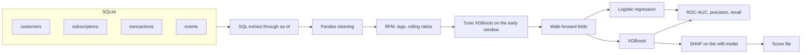

# AlphaChurn

AlphaChurn estimates which subscription customers will cancel in the next 30 days, and it writes a short reason beside each score.

A local run uses SQLite and a synthetic history. The SQL, the Pandas snapshots, and the training loop are the pieces you would point at a warehouse extract with the same four tables: customers, subscriptions, transactions, and product events. The stack is Python, SQL, Pandas, NumPy, scikit-learn, XGBoost, SHAP, and PyTest.

## What it predicts

Each row is a customer who is still active at a month-end. The label is 1 when that subscription's end date falls on or before 30 days after the month-end. Features are built only from activity dated on or before the month-end. Customers who have already ended are left out of the snapshot.

The last labeled month-end in the bundled calendar is 2024-11-30. Scoring defaults to 2024-12-31, the following month-end, which is not a training row.

## Features

- SQL extracts the four tables through an as-of date.
- Pandas cleans types, drops bad rows, and builds point-in-time features:
  - RFM: recency of the last purchase, 90-day and lifetime frequency, 90-day and lifetime monetary value.
  - Time-windowed lags: spend and logins in the three 30-day windows before the latest one.
  - Rolling ratios: latest 30 days divided by the trailing 90 days, for spend, purchase count, and logins.
  - Support tickets, failed payments, tenure, plan fee, and a 90-day refund ratio.
- Logistic regression is the baseline. XGBoost is tuned on an early month, then both models are scored with walk-forward validation.
- Each fold reports ROC-AUC, precision, and recall at one shared threshold.
- Training refits both models, writes the fold table, and writes SHAP importance for the boosted model.
- Scoring writes a churn probability and the top three SHAP reasons for every customer still active on the score date.

## Architecture



Training reads history through the end of the calendar in four queries. Pandas then rebuilds a snapshot at each labeled month-end. The XGBoost grid is scored on the tuning month only. Later folds train on every earlier snapshot, including that tuning month, and validate on the next month. Logistic regression is fit on the same rows.

`artifacts/cv_metrics.csv` holds those fold scores. After the comparison, both models are refit on every labeled snapshot and saved. SHAP importance is the mean absolute contribution on the latest labeled snapshot of the refit boosted model. It describes that fit. The fold table is the accuracy report.

Scoring runs the SQL extract at the score date, builds one snapshot with the same feature code, and applies `artifacts/xgboost.joblib`.

## Folder structure

```
sql/                         schema and the four as-of extracts
src/alphachurn/cli.py        generate, train, and score commands
src/alphachurn/generate.py   synthetic subscription history
src/alphachurn/extract.py    runs the SQL files
src/alphachurn/features.py   cleaning, RFM, lags, rolling ratios
src/alphachurn/splits.py     tuning window and walk-forward folds
src/alphachurn/models.py     logistic baseline and XGBoost
src/alphachurn/metrics.py    ROC-AUC, precision, recall
src/alphachurn/train.py      comparison, refit, SHAP importance
src/alphachurn/explain.py    TreeExplainer helpers
src/alphachurn/score.py      probabilities and local reasons
tests/                       PyTest
```

`data/alphachurn.db` and `artifacts/` are created when you run the commands. Paths are set in `.env`.

## How to run locally

From the repository root:

```bash
python -m venv .venv
source .venv/bin/activate
pip install -e ".[dev]"
cp .env.example .env
python -m alphachurn.cli generate
python -m alphachurn.cli train
python -m alphachurn.cli score
```

`generate` writes a few hundred customers. Plans, channels, and regions vary, and customers who are about to cancel usually show a quiet month first: fewer logins and add-on purchases, more tickets and failed payments, then an end date in the next month. A smaller group cancels without that slowdown. The seed in `.env` makes the file repeatable.

`train` prints the fold table and the mean ROC-AUC, precision, and recall by model. It writes:

| File | Contents |
| --- | --- |
| `artifacts/cv_metrics.csv` | One row per fold and model |
| `artifacts/cv_summary.csv` | Mean of the three metrics by model |
| `artifacts/run.json` | Seed, tuning month, parameters, threshold |
| `artifacts/logistic.joblib` | Refit baseline |
| `artifacts/xgboost.joblib` | Refit boosted model used for scoring |
| `artifacts/shap_importance.csv` | Mean absolute SHAP by feature |
| `artifacts/shap_importance.png` | Bar chart of that table |

`score` writes `artifacts/scores.csv`, sorted by churn probability. The reason columns are SHAP values on the log-odds margin. A positive value pushed the customer toward churn.

Useful overrides:

```bash
python -m alphachurn.cli generate --customers 200 --seed 7
python -m alphachurn.cli score --as-of 2024-12-31 --threshold 0.5
```

Environment variables, also listed in `.env.example`:

| Variable | Default | Role |
| --- | --- | --- |
| `ALPHACHURN_DB_PATH` | `data/alphachurn.db` | SQLite file |
| `ALPHACHURN_ARTIFACT_DIR` | `artifacts` | Models, metrics, scores |
| `ALPHACHURN_SEED` | `42` | Generator and model seeds |
| `ALPHACHURN_N_CUSTOMERS` | `500` | Size of the synthetic book |
| `ALPHACHURN_MIN_TRAIN_PERIODS` | `4` | Earliest months used before the first test month |
| `ALPHACHURN_THRESHOLD` | `0.5` | Cutoff for precision, recall, and `predicted_churn` |

No credentials are required for the local path. The SQL uses a single named parameter, `:as_of`, and ISO dates.

## How to test

```bash
pytest
ruff check src tests
ruff format --check src tests
```

`make test` and `make lint` run the same checks. The tests that fit models use a small grid and a 180-customer book so they stay short. Feature tests use a hand-built customer with known window boundaries, so a shifted lag fails even if a model test still passes.

## Design decisions

**As-of cut in two places.** Each extract file filters with `date <= :as_of`. Training calls the files with the last day of generated history, and the snapshot code applies the same predicate at every month-end. Scoring passes the score date into SQL, so the frame for that run has no later events. A regression test adds a purchase after the as-of date and checks that the feature row is unchanged.

**Status is not a feature.** `subscriptions.status` stores how the row ended up. A snapshot decides who is still active from `start_date` and `end_date`. Using status would mark a customer cancelled on every earlier month-end once the final value was written back.

**Window edges.** Lags are 30 days, open on the left and closed on the right. The day that sits on the boundary belongs to the older window, so spend is not counted twice. The 90-day RFM total is the latest window plus the two lags behind it, which is why `spend_ratio_30_90` is `spend_30d / monetary_90d`. A zero denominator becomes 0. Recency for a customer with no purchase is their tenure, which treats "never paid" as stale rather than as a purchase today.

**Refunds stay out of monetary value.** Purchase amount is subscription charges plus add-ons. Refunds feed `refund_ratio_90d` only.

**Walk-forward, with tuning parked on an early month.** A shuffled split would train on a later month of the same book while scoring an earlier one. Features would still be point-in-time, and the estimate would still be rosy, because the model would have seen how the book moved afterward. Each validation month here is strictly after every training month.

The grid is small: depth, learning rate, `min_child_weight`, and row and column sampling. It is chosen by ROC-AUC on the last month of the minimum training window (2024-05-31 with the defaults). That month is not used as a test month. Folds from 2024-06-30 onward reuse the chosen parameters. `scale_pos_weight` is `negatives / positives` on the rows inside that fit, so the validation month does not set it. Logistic regression uses the same columns, with `StandardScaler` on the numeric ones, L2, and `class_weight="balanced"`.

Precision and recall both use probability 0.5. The cutoff is there so the two models are counted the same way. It is not a policy for who should get a retention offer.

**What gets published.** Fold metrics come from the walk-forward loop. The saved pipelines are a later refit on all labeled snapshots, which is what scoring loads. SHAP on that refit is an explanation of the shipped model, not another accuracy figure.

**SHAP.** `TreeExplainer` runs on the XGBoost booster. Contributions are in log-odds. The score file keeps the three features with the largest absolute contribution for that customer. XGBoost writes `base_score` as a one-element list; the explainer code turns that into a float before building the explainer, which is what current SHAP builds expect.
